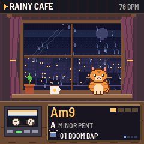

# NOOK: a lo-fi band for the M-VAVE FM-1

NOOK turns the FM-1 into a lo-fi band to jam over on guitar. Pick a mood and press PLAY. An electric piano and a
bass make up their parts every bar from the mood's chord loop, the drums play one of 20 patterns, and the tape
crackles and wobbles. The screen shows a pixel-art room with a window onto one of eight views, a cat on the sill who
keeps time, a cassette deck, and what you need while you play: the chord now, the key and scale, the drum pattern
and the tempo.

Built on [fm1-base](https://github.com/charlesvestal/fm1-base) and [felucca-bsp](https://github.com/hugelton/felucca-bsp),
the same platform as [OSR-1 / Blop](https://github.com/OSR-Experiment/OSR-1).

**Status: prototype. It has not been tested on a real FM-1 yet.** It runs in fm1-base's host simulator (tests,
screenshots, audio) and in the browser emulator. Read "Before you flash" below.



## Controls

| Control | What it does |
| --- | --- |
| **SELECT** (encoder) | Mood (12). Each mood sets its own key, scale, tempo and keys sound. |
| **ALGORITHM** (encoder) | Drum pattern (20), each with its own kit. |
| **PRESET** (encoder) | The view out of the window: AUTO (follows the mood) or one of 8 views. |
| **K1–K4** | The knobs of the current page (below). A card shows all four while you turn. |
| **ENV** | GROOVE page. Press it again to go back to MIX. |
| **FX** | TAPE page. Press it again to go back to MIX. |
| **HOME** | Back to the MIX page. **Hold** it for the help screen. |
| **The 27 keys** | Set the song's key: the note you press becomes the root (its octave doesn't matter). |
| **OCT− / OCT+** | Key down / up a semitone. |
| **PLAY** | Start / stop. When it stops, the band lets the last notes ring out. |
| **REC** | Tap tempo (tap 2–5 times). While playing, REC flashes on each beat. |
| **SEQ** | Drums sit out / come back in (from the next bar). Good for a quiet verse. |
| **ARP** | How the keys play: AUTO, PADS, STRUM, COMP, ARP, SPARSE. |
| **LFO** | How the bass plays: AUTO, HOLD, BOUNCE, WALK, OFF. |
| **SEL** | Scale map: the scale on a guitar fretboard (frets 0–12, roots in the accent colour, the current chord's tones marked). |
| **EDIT** | Window only: hides the words. |
| **GLO** | The cat's coat: ginger, midnight, smoke, calico. |
| **SAVE** | Save now. Settings also save on their own 4 seconds after the last change. |
| **MASTER** | Volume. |

**Knob pages**

| Page | K1 | K2 | K3 | K4 |
| --- | --- | --- | --- | --- |
| MIX (HOME) | Tempo (50–160 BPM) | Drums level | Bass level | Keys level |
| GROOVE (ENV) | Swing | Variation | Density | Outside (the window's ambience level) |
| TAPE (FX) | Crackle | Wow & flutter | Tone (dark to bright) | Reverb |

- **Variation** sets how much the band improvises. At 0 every pass of the loop is identical, which is handy for
  practising a part. Higher values bring more re-voicings, new comping and bass rhythms, fills and little melodic
  answers.
- **Density** sets how busy the keys, bass and ghost notes are.
- **Outside** is the sound beyond the window, which depends on the view: rain, crickets, wind, waves or the hum of a
  ship in orbit.

**Lights.** The keys show the scale: dim keys are scale notes, bright keys are the root, and the medium-lit key is
the current chord's root, which moves through the progression. Buttons that are on light up: PLAY (green), SEQ, FX
or ENV for the page, SEL, EDIT, ARP or LFO when you've overridden the mood's style, and SAVE when there are unsaved
changes.

**Changes land on the bar.** A new mood, key or drum pattern takes over at the next bar line, so you can switch
while playing without a stumble.

## The moods

Most are pentatonic, blues or dorian. Every mood is a loop of one chord per bar.

| # | Mood | Key / scale | BPM | Loop | Keys | View |
| --- | --- | --- | --- | --- | --- | --- |
| 1 | Rainy Cafe | A minor pent | 78 | Am9 – Dm9 – Fmaj7 – Em7 | felt piano, comping | rain city |
| 2 | Late Night | D dorian | 72 | Dm9 – G13 – Dm9 – Cmaj9 | Rhodes, pads | neon street |
| 3 | Sunday Blues | E blues | 84 | E9 – A13 – E9 – E9 – A13 – A13 – E9 – B7#9 | Wurli, comping, walking bass | sunset hills |
| 4 | Moonlit | E minor pent | 70 | Em9 – Cmaj9 – Am9 – Bm7 | dream EP, sparse | moon beach |
| 5 | City Lights | A dorian | 88 | Am9 – Bm7 – Cmaj7 – D9 | Rhodes, comping | neon street |
| 6 | Sakura | D major pent | 82 | Dmaj9 – Bm9 – Gmaj9 – A9sus | felt piano, arpeggios | cherry hill |
| 7 | Slow Burn | A blues | 66 | Am9 – D9 – Am9 – E7#9 | Wurli, strummed | sunset hills |
| 8 | Coffee Steam | C major pent | 86 | Fmaj7 – Em7 – Dm9 – Cmaj9 | Rhodes, walking bass | autumn park |
| 9 | Stargazer | B minor pent | 74 | Bm9 – Gmaj7 – Em9 – F#m7 | dream EP, arpeggios | orbit |
| 10 | Snowfall | G mixolydian | 76 | G9 – Fmaj9 – Cmaj9 – Dm9 | felt piano, sparse | snowy pines |
| 11 | Haze | F# minor pent | 80 | F#m9 – Dmaj7 – Bm9 – C#m7 | dream EP, pads | rain city |
| 12 | Rooftop | E dorian | 92 | Em9 – A9 – Gmaj7 – F#m7 | Rhodes, comping | sunset hills |

When you change the key, the whole mood transposes.

## The drum patterns

1 Boom Bap · 2 Dilla Sway (laid-back snare) · 3 Lazy Sunday · 4 Half Time · 5 Rim Shot · 6 Brushes · 7 Bossa ·
8 Shuffle · 9 Trap Lite · 10 Dusty 2-Step · 11 Knock · 12 Side Stick · 13 Heartbeat · 14 Stroll · 15 Skip Hop ·
16 Tape Loop · 17 Breakbeat · 18 Nodding · 19 Stepper · 20 Minimal

Each pattern uses one of four kits (dusty, warm, crisp, soft) played through an old-sampler stage: sample-and-hold,
fewer bits, a low-pass. Some patterns put a floor under the swing knob (a shuffle stays a shuffle) or lay the snare
back.

## MIDI and USB audio

Over USB, NOOK sends everything it plays: the keys on channel 1, the bass on channel 2 and the drums on channel 10
(General MIDI drum notes), plus MIDI clock with start and stop. You can record the parts into a DAW or slave a
looper to it. The FM-1 also shows up as a USB audio input, so you can record the band's sound directly.

## Build

```sh
git clone --recursive <this repo> nook && cd nook     # or: tools/setup.sh after unzipping
pip install Pillow fonttools

# host simulator: tests, screenshots (PNG) and audio (WAV) in build/host/
python3 fm1-base/tools/build.py . --host
build/host/nook_host tests/basic.txt build/host
build/host/nook_host tests/themes.txt build/host

# browser emulator (Zig instead of Emscripten), then open http://localhost:8000
pip install ziglang && tools/build_web.sh
python3 -m http.server -d build/emu

# the firmware (Linux x86-64; JieLi's toolchain and three files of the AC79 SDK)
fm1-base/tools/get_toolchain.sh ~/.jieli && fm1-base/bsp/tools/get_sdk.sh ~/.jieli/ac79-sdk
JIELI_TOOLCHAIN=~/.jieli/toolchain AC79_SDK=~/.jieli/ac79-sdk python3 fm1-base/tools/build.py .
# -> build/nook.fwsc
```

**The easy way:** push this folder to a GitHub repository. `.github/workflows/build.yml` runs the simulator tests,
builds the browser emulator and the firmware on GitHub's machines (they can reach JieLi's toolchain server), and
puts `nook.fwsc` in the run's artifacts (Actions tab, then the run, then "nook-firmware"). Pushing a tag such as
`v0.1.0` also makes a GitHub release.

## Before you flash

- NOOK has not run on hardware yet. The simulator runs the same code, but timing, CPU load and the screen's speed
  on the real chip are still to be confirmed.
- Install with `python3 fm1-base/tools/fm1_install.py build/nook.fwsc` (needs `pip install mido python-rtmidi`), or
  with the FM-1 Firmware Hub or web installer that other fm1-base firmwares use. felucca-bsp's README covers
  `fm1_rescue`, which puts the stock firmware back on an FM-1 that can't start.
- Before a public release, fill in `author`, `repo` and `install` in `fm1.toml`, and check that the package
  identity `id_prefix = "FM-1_57"` isn't used by another firmware.

## Files

- `app.c`: controls, settings, the pixel-art room (drawn at 120 × 120, shown 2×) and the words over it
- `dsp/lofi.c`: the band: electric piano (FM, 4 sounds), bass, drums (kick, snare/clap, hats, rim, shaker), the
  generative parts, wow and flutter, reverb, crackle, sidechain, the ambiences
- `dsp/music.h`: the moods, chord qualities, scales, drum patterns and themes. Edit this file to add your own.
- `tests/`: simulator scripts

## Licence

MIT (see `LICENSE`). fm1-base and felucca-bsp stay under MPL-2.0. A built package contains three files from
JieLi's AC79 SDK (Apache-2.0).
